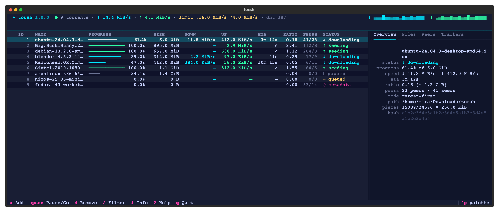
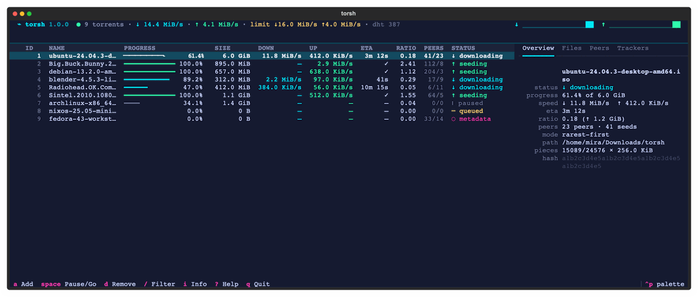
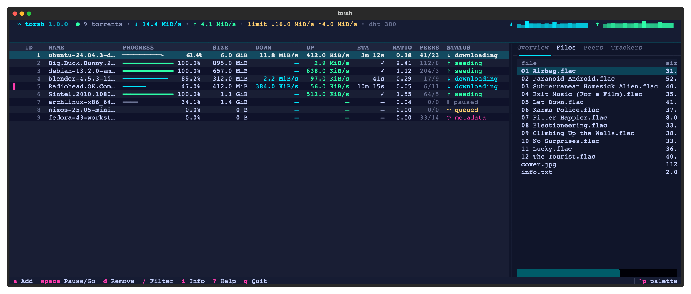
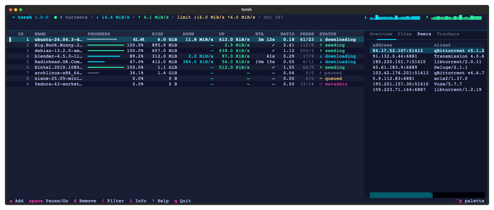
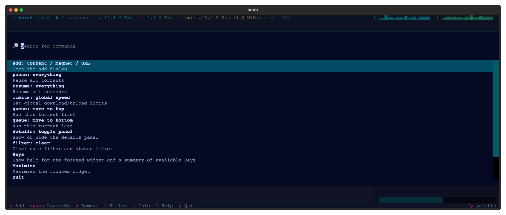

<div align="center">

# ⌁ torsh

**A self-contained BitTorrent client for your terminal.**

Engine included. One `pip install`, zero setup — a background daemon keeps
seeding while a scriptable CLI and a keyboard-driven TUI stay out of your way.

[](https://github.com/sowhoia/torsh/actions/workflows/ci.yml)
[](https://pypi.org/project/torsh/)
[](https://www.python.org/downloads/)
[](https://libtorrent.org)
[](https://textual.textualize.io/)
[](LICENSE)

<br>



<sub>**The dashboard.** Live table, speed sparklines, a details panel —
overview, files, peers and trackers for whatever the cursor is on.</sub>

<br>



<sub>**Type to filter, `ctrl+p` for everything.** The fuzzy filter narrows the
list as you type; the command palette holds every action torsh can do.</sub>

</div>

---

## Why torsh

Most terminal torrent clients are remote controls: install a daemon by hand,
configure RPC ports and passwords, then point a UI at it. **torsh ships the
whole stack** — the engine ([libtorrent 2.0](https://libtorrent.org), the same
core as qBittorrent), its own lightweight daemon, a `gh`-style CLI and a
[Textual](https://textual.textualize.io) dashboard — in a single Python
package with prebuilt wheels for Linux and macOS.

```bash
pipx install torsh
torsh add "magnet:?xt=…"     # daemon autostarts, download begins
torsh                        # watch it in the TUI; quit — it keeps going
```

| | |
|---|---|
| 🔋 **Batteries included** | Embedded libtorrent engine — no external daemon, no sudo, no RPC passwords |
| 👻 **Background daemon** | Spawned on demand over a private Unix socket; downloads survive closing the UI |
| ⚡ **Scriptable CLI** | `add · ls · get · pause · rm …` with humane selectors and `--json` everywhere |
| 🖥 **Live dashboard** | Fuzzy filter, multi-select, files/peers/trackers, speed sparklines, command palette |
| 🎬 **Streaming mode** | Sequential download per torrent (`torsh seq movie on`) — watch while it fetches |
| 🎯 **Per-file control** | Priorities incl. skip: `torsh prio ubuntu 3=skip 0=high` |
| 🔢 **Queue control** | `torsh queue ubuntu top` jumps the line; `shift+↑/↓` in the TUI |
| 📉 **Human units** | `torsh speed 4M 1M`, `torsh limit ubuntu 500K`, `off` to lift |
| 🧲 **Magnet-native** | DHT out of the box, metadata persisted on arrival, `torsh export` writes it back to a `.torrent` |
| 💾 **Crash-safe resume** | Fast-resume data (with the info dict) saved continuously and on shutdown |
| 🩺 **Self-diagnosing** | `torsh doctor` checks the engine, disk, daemon and DHT in one go |

## 📦 Install

```bash
pipx install torsh        # recommended — isolated, always on your PATH
# or
pip install torsh
```

Python **3.10 – 3.13**. Prebuilt libtorrent wheels cover Linux
(x86_64/aarch64, glibc & musl) and macOS (Apple Silicon & Intel); on Windows
use WSL. Nothing else to install.

> **Upgrading from torsh 0.x?** 1.0 replaces the Transmission integration
> with an embedded engine. Old transmission-daemon setups keep working on
> their own; torsh no longer manages them. Your download directory setting
> migrates automatically.

## 🚀 The CLI

```console
$ torsh add ubuntu.torrent "magnet:?xt=…" -d ~/isos
✓ added ubuntu-24.04-desktop-amd64.iso #1 · 5.7 GiB
✓ added Fedora-Workstation-42 #2 · fetching metadata…

$ torsh ls --status downloading
ID  NAME                        PROGRESS          SIZE      DOWN     ETA  STATUS
 1  ubuntu-24.04-desktop-amd64  ▮▮▮▮▮▮▯▯  61.4%   5.7 GiB   12 MiB/s 3m   ↓ downloading

$ torsh pause all && torsh resume ubuntu
$ torsh queue fedora top              # jump the download queue
$ torsh export ubuntu ~/torrents/     # metadata back out as a .torrent
$ torsh rm done -y                    # clear out everything finished
```

Every command that targets torrents takes **selectors** — no copy-pasting
infohashes:

| `torsh …` | means |
|---|---|
| `3` | the torrent with id 3 |
| `ubuntu` | any name containing *ubuntu* |
| `e2467d` | any infohash with this prefix |
| `all` · `active` · `paused` · `done` | groups |
| `seeding` · `downloading` · `errored` | …more groups |

One-shot downloads, `wget`-style — Ctrl+C detaches instead of killing:

```console
$ torsh get "magnet:?xt=…" --sequential
⠸ Big.Buck.Bunny ━━━━━━━╸ 62% 170/277 MiB 21 MiB/s eta 0:05
```

Scripting is first-class: `--json` on every read command, data on stdout,
status on stderr, exit codes you can trust — and `add -` takes a URI per line
from stdin.

```bash
torsh ls --json | jq -r '.[] | select(.progress < 1) | .name'
grep -o 'magnet:[^"]*' page.html | torsh add - --paused
```

<details>
<summary><b>Full command list</b></summary>

| Torrents | Tuning | System |
|---|---|---|
| `add` — magnets, files, URLs, infohashes (`-` reads stdin) | `speed` — global limits | `daemon run/start/stop/restart/status/log` |
| `get` — foreground download | `limit` — per-torrent limits | `config list/get/set/path/edit` |
| `ls` — filter/sort/`--watch`/`--json` | `seq` — sequential mode | `doctor` — health checks |
| `info` / `files` / `peers` / `trackers` | `prio` — file priorities | `completion` — bash/zsh/fish |
| `pause` / `resume` / `rm` | `queue` — reorder the download queue | |
| | `export` — write a `.torrent` back out | |
| | `move` / `verify` / `reannounce` / `stats` | |

</details>

## 🖥 The TUI

`torsh` with no arguments opens the dashboard. The details panel follows the
cursor — per-file priorities, who you're swapping bytes with, what the
trackers say:

<div align="center">
<table><tr>
<td></td>
<td></td>
</tr></table>
<sub><b>Files</b> — progress and priority per file · <b>Peers</b> — client, speeds, completion</sub>
</div>

<br>

- **`ctrl+p`** — command palette: every action, fuzzy-searchable
- **`/`** — fuzzy filter as you type · **`f`** cycles status filters
- **`x`** / **`*`** — select rows; actions apply to the whole selection
- **`space`** pause/resume · **`d`** remove (keep or delete files) · **`s`** streaming mode
- **`shift+↑/↓`** — move a torrent up or down the download queue
- **`1–8`** or click a header to sort · **`i`** details · **`?`** everything else

<div align="center">



<sub>**`ctrl+p`, then type.** Add, pause everything, move a torrent to the top
of the queue — all discoverable from the keyboard.</sub>

</div>

Quit freely — the daemon keeps seeding. `torsh daemon stop` when you mean it.

## ⚙️ Configuration

`~/.config/torsh/config.toml`, created on first run, editable live
(`torsh config set … `applies to the running daemon immediately):

```toml
[downloads]
dir = ""                    # empty = ~/Downloads/torsh
sequential = false          # default for new torrents

[limits]
download = 0                # bytes/s — or set via `torsh speed 4M`
upload = 0
ratio = 0.0                 # pause seeding at this share ratio (0 = never)

[network]
port = 0                    # listen port (0 = random)
dht = true
encryption = "prefer"       # require | prefer | allow

[daemon]
autostart = true            # any command may start the daemon
```

`TORSH_CONFIG_DIR`, `TORSH_STATE_DIR`, `TORSH_CACHE_DIR`,
`TORSH_DOWNLOAD_DIR`, `TORSH_PORT` and `TORSH_LOG_LEVEL` override per
environment (plus `TORSH_SOCKET` / `TORSH_DEBUG` for the adventurous).
State — resume data, session state, logs — lives in `~/.local/state/torsh`;
the RPC socket sits in a private 0700 directory named `torsh-<uid>` inside the
system temp dir, tmux-style.

## ❓ FAQ

<details>
<summary><b>I closed the TUI — is my download still running?</b></summary>
<br>

Yes. The daemon owns the engine and outlives every frontend. Check in with
`torsh speed` or `torsh ls --watch`; stop it for real with `torsh daemon stop`.
</details>

<details>
<summary><b>Something looks wrong — how do I debug it?</b></summary>
<br>

`torsh doctor` checks the engine, config, disk space, state dir, daemon and
DHT in one pass. The daemon log is at `~/.local/state/torsh/daemon.log`
(`torsh daemon log` tails it).
</details>

<details>
<summary><b>Does it work on Windows?</b></summary>
<br>

Use WSL. Native Windows is not supported — the daemon's shutdown path assumes
POSIX signals.
</details>

## 🛠 Development

```bash
git clone https://github.com/sowhoia/torsh && cd torsh
make dev      # uv venv + editable install (with dev extras)
make test     # full suite: engine, daemon, CLI, TUI — real transfers included
make cov      # ...with a coverage report
make lint     # ruff check + ruff format --check + mypy (config in pyproject.toml)
make fmt      # apply the formatter
```

The stack is small and layered; each layer only talks to the one below:

| Module | Responsibility |
|---|---|
| `torsh/engine.py` | libtorrent session: alerts, resume data, status cache |
| `torsh/daemon.py` | background service + JSON-RPC over a Unix socket |
| `torsh/ipc.py` | sync (CLI) and async (TUI) clients, daemon autostart |
| `torsh/cli/` | rich-click commands, selectors, rendering |
| `torsh/tui/` | Textual app: table diffing, palette, modals |
| `torsh/config.py` · `units.py` · `paths.py` | TOML config, human units, XDG paths |
| `torsh/atomic.py` | the one durable-write path every persisted file uses |

The test suite favours integration over mocks: it seeds a real torrent from a
second libtorrent session and downloads it through the entire stack
(engine → daemon → socket → CLI).

The README screenshots are real app frames — regenerate them after UI changes
with `python scripts/make_screenshots.py && python scripts/render_assets.py`.

## 📝 License

MIT © torsh authors — see [LICENSE](LICENSE).
